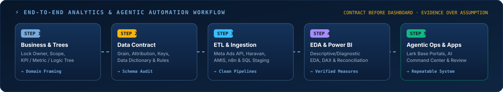
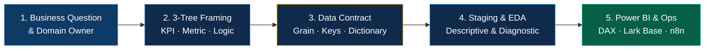

- 🎓 **Data Science** undergraduate at **International University – VNU-HCM (HCMIU)** (`Ho Chi Minh City, VN`)
- ⚡ Building **AI Agentic Analytics**, **Marketing Data Contracts (Meta Ads / E-Com)** & **n8n + Lark Base Workflows**
- 🧭 **Core Principle:** `Domain Framing` → `Data Contract & Schema Audit` → `Automated ETL` → `Verified BI & Ops`

  
  
  
  
  

<picture>
  <source media="(prefers-color-scheme: dark)" srcset="https://raw.githubusercontent.com/duytrinh-data/duytrinh-data/output/github-snake-dark.svg" />
  <source media="(prefers-color-scheme: light)" srcset="https://raw.githubusercontent.com/duytrinh-data/duytrinh-data/output/github-snake.svg" />
  
</picture>

---

### ⚡ Executive Summary

Hi, I'm **Trịnh Đình Duy** (`duytrinh-data`) — a **Data Science undergraduate at International University – VNU-HCM (HCMIU)** and **Analytics / Business Automation Builder** based in Ho Chi Minh City.

I focus on bridging **business domain logic**, **data contracts**, and **AI-assisted workflow automation** so teams can move from raw operational data to verified decisions:

- 📊 **Marketing & E-Commerce Analytics:** Designing **KPI Trees, Metric Trees, Logic Trees**, and **Data Contracts** for Meta Ads & e-commerce datasets before building **Power BI (DAX)** models.
- 🔄 **Workflow & Data Automation:** Building scheduled data pipelines from **Meta Ads API, MISA AMIS, and spreadsheets** into **Lark Base** using **n8n, Python, and REST APIs**.
- 🧠 **Agentic Workspaces & Full-Stack Command Centers:** Developing context-driven AI operating systems (`Duy AI OS`), interactive **TypeScript / React / Three.js** applications, and **Lark Base** operational portals (HRM, Payroll & Knowledge Hubs).

  

---

### 🛠️ Tech Stack & Tooling Matrix

  

<table>
  <tr>
    <td width="33%" valign="top">
      <h4>📊 Data Science &amp; BI</h4>
      

        
        
        
        
        
        
      

      Data Dictionary design, grain &amp; attribution locking, formula reconciliation in Excel/SQL prior to BI visualization.
    </td>
    <td width="33%" valign="top">
      <h4>⚙️ Automation &amp; Operations</h4>
      

        
        
        
        
        
      

      Scheduled API ingestion, HRM &amp; payroll relational schema design, lookup/formula automation, and RAG document indexing.
    </td>
    <td width="34%" valign="top">
      <h4>💻 Application Engineering</h4>
      

        
        
        
        
        
      

      Full-stack Lark Base web apps, real-time multiplayer 3D web experiences (Colyseus + Three.js), and productivity platforms.
    </td>
  </tr>
</table>

---

### 🚀 Featured Repositories & Engineering Showcases

<table>
  <tr>
    <td width="50%" valign="top">
      <h4>🧠 <a href="https://github.com/duytrinh-data/neuralops-command-center">neuralops-command-center</a></h4>
      
<strong>Full-Stack AI &amp; Operations Command Center</strong>

      
Interactive operational hub combining knowledge management, telemetry dashboards, schedule orchestration, and AI agent workflows.

      
<code>TypeScript</code> · <code>React</code> · <code>Agentic UI</code>

    </td>
    <td width="50%" valign="top">
      <h4>⚔️ <a href="https://github.com/duytrinh-data/rift-duel">rift-duel</a></h4>
      
<strong>3D Multiplayer Platform Fighter</strong>

      
Real-time networked 3D arena brawler engineered with <strong>Three.js</strong> WebGL rendering and <strong>Colyseus</strong> authoritative multiplayer state synchronization.

      
<code>TypeScript</code> · <code>Three.js</code> · <code>Colyseus</code>

    </td>
  </tr>
  <tr>
    <td width="50%" valign="top">
      <h4>🔄 <a href="https://github.com/duytrinh-data/GET_NVL_AMIS">GET_NVL_AMIS</a></h4>
      
<strong>MISA AMIS Inventory &amp; Material Data Pipeline</strong>

      
Automated extraction and transformation utility for syncing enterprise material/inventory records from MISA AMIS into structured reporting tables.

      
<code>JavaScript</code> · <code>REST API</code> · <code>ETL Automation</code>

    </td>
    <td width="50%" valign="top">
      <h4>📋 <a href="https://github.com/duytrinh-data/PDM_TaskFlow">PDM_TaskFlow</a></h4>
      
<strong>Modern Task Management &amp; Productivity Platform</strong>

      
Structured project and task tracking web application designed for clear ownership, status transitions, and deadline visibility.

      
<code>TypeScript</code> · <code>Full-Stack Web</code> · <code>Productivity</code>

    </td>
  </tr>
  <tr>
    <td width="50%" valign="top">
      <h4>📊 <a href="https://github.com/duytrinh-data/Statistic_method">Statistic_method</a> &amp; <a href="https://github.com/duytrinh-data/HackerRank-SQL-Solutions">SQL Solutions</a></h4>
      
<strong>Applied Statistics &amp; Analytical SQL Corpus</strong>

      
Jupyter notebooks covering statistical inference, hypothesis testing, and window-function / CTE query patterns for data analysis.

      
<code>Jupyter Notebook</code> · <code>Python</code> · <code>T-SQL</code>

    </td>
    <td width="50%" valign="top">
      <h4>📄 <a href="https://github.com/duytrinh-data/pdf-to-markdown">pdf-to-markdown</a> &amp; <a href="https://github.com/duytrinh-data/markitdown">markitdown</a></h4>
      
<strong>Document-to-Markdown Pipelines for LLM Context</strong>

      
Tools for converting complex PDFs, spreadsheets, and office documents into clean Markdown for AI agents and reasoning-based RAG.

      
<code>Python</code> · <code>HTML</code> · <code>LLM Context Engineering</code>

    </td>
  </tr>
</table>

---

### 🧭 Operating Contract & Analytics Discipline

1. **No Jumping Layers:** A clean dashboard cannot compensate for an unverified Data Contract. Every metric must trace back to its source table, grain, denominator, and business owner confirmation.
2. **Evidence Segregation:** Strictly distinguish between *System-Verified Evidence*, *Domain Owner Confirmation*, and *Analytical Hypotheses*.
3. **Human-in-the-Loop AI:** Use AI agents, MCP servers, and code generation to accelerate execution while maintaining full human ownership over input definitions, core logic, failure modes, and verification tests.

---

  Built &amp; maintained by <strong>Trịnh Đình Duy (@duytrinh-data)</strong> · Ho Chi Minh City, Vietnam 🇻🇳

